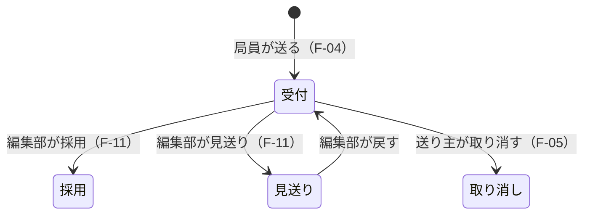
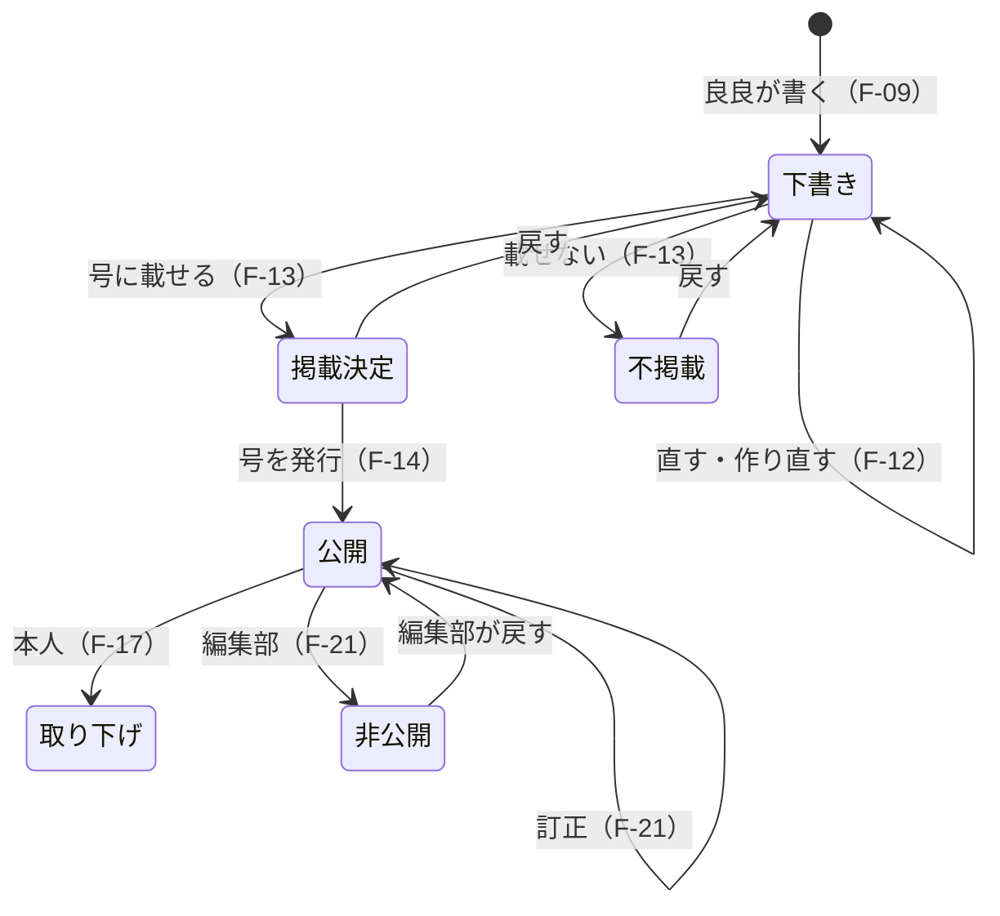
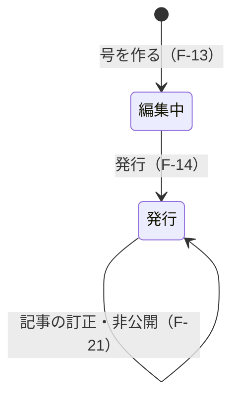
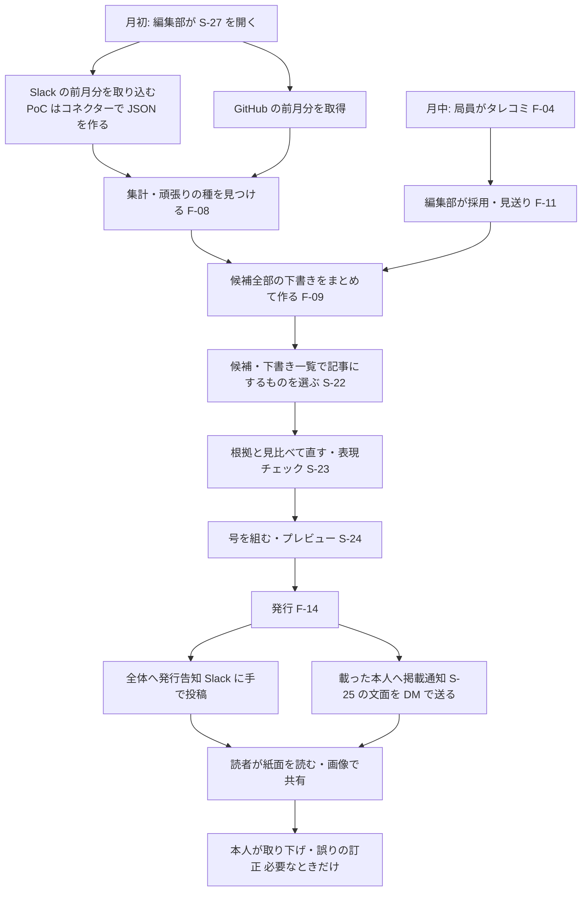
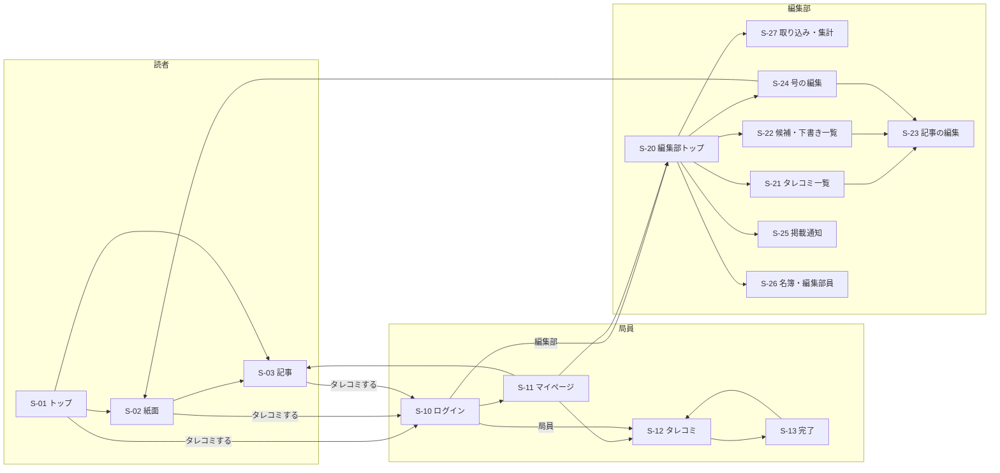

# 良良タイムズ 基本設計（作成中）

## 1. 位置づけ
要件定義（`ryanryan-times.md`）の要求 1〜11 を満たすための、機能・画面・流れを決める。API名、データ項目、画面の細かい配置は詳細設計で決める。

## 2. 機能一覧（案）

| ID | 機能 | 概要 | 主な利用者 | 要求 |
|---|---|---|---|---|
| F-01 | Slack ログイン | Sign in with Slack。NUTMEG ワークスペースの人だけ通す。編集部かどうかで使える機能を分ける | 局員・編集部 | 1, 5, 8, 9 |
| F-02 | 局員名簿 | 局員の一覧（名前・Slack ID・GitHub アカウント）。Slack のメンバーから取り込み、GitHub アカウントは本人か編集部が紐付ける | 編集部・局員 | 3, 9 |
| F-03 | 編集部員の管理 | 編集部に人を加える・外す | 編集部 | 5 |
| F-04 | タレコミの投稿 | 対象者を選び、何が良かったかを書いて送る。記名／匿名を選ぶ。関連リンク（Slack 投稿や PR）を任意で添える | 局員 | 1, 2 |
| F-05 | 自分のタレコミの確認・取り消し | 自分が送ったタレコミと、その状態（受付・採用・見送り）を見る。受付中なら取り消せる | 局員 | 1 |
| F-06 | GitHub 活動の取得 | nutfes org の全リポジトリから、月ごとのコミット・PR・レビュー・Issue・コメントを取る | システム | 3 |
| F-07 | Slack 活動の取得 | 公開チャンネル全部から、月ごとの投稿・スレッド返信・リアクションを取る。PoC ではコネクターで取った JSON を取り込む | システム | 3 |
| F-08 | 頑張り候補の検出 | 取得した活動から「記事の種」を見つける。種類は量・支え・伸び・初挑戦・反応・継続。オプトアウト中の人は除く | システム | 3, 9 |
| F-09 | 記事の下書き生成 | 良良（Gemini）が、種とタレコミから見出し・本文・記者コメントを書く。根拠（数字・元の投稿・タレコミ本文）を添える | システム | 4 |
| F-10 | 表現チェック | 下書きと編集後の本文に、比較で下げる表現・ミスや不在への言及がないかを調べて警告する | システム・編集部 | 11 |
| F-11 | タレコミの管理 | 届いたタレコミを一覧し、採用・見送りを決める。匿名でも送り主が見える。採用したら下書きを作る | 編集部 | 2, 5 |
| F-12 | 記事の編集 | 下書きの見出し・本文・記者コメントを直す。根拠を並べて見られる。下書きを作り直せる | 編集部 | 5, 11 |
| F-13 | 号の編集 | 号（月刊／年間特大号）を作り、記事を掲載決定・不掲載に振り分け、トップ記事と並び順を決める。発行前に紙面をプレビューする | 編集部 | 5, 6 |
| F-14 | 号の発行 | 号を発行し、掲載決定の記事を公開する | 編集部 | 5, 7 |
| F-15 | 紙面の閲覧 | 号の一覧、号の紙面、記事の個別ページを見る。ログイン不要 | 読者 | 7 |
| F-16 | 記事の画像保存 | 記事を SNS・Slack 向けの画像で保存する | 読者 | 10 |
| F-17 | 自分の記事の取り下げ | 自分が載った記事を一覧し、取り下げる。取り下げた記事は紙面から消える | 局員 | 8 |
| F-18 | オプトアウト | 「記事にしないで」を設定・解除する。設定中は集計・下書き・タレコミの対象外 | 局員 | 9 |
| F-19 | 年間特大号の素材集め | 1 年分の掲載記事と年間の集計から、年間特大号の下書きを作る | システム | 6 |

| F-21 | 発行後の訂正・非公開 | 公開中の記事を編集部が直して公開し直す。問題があれば非公開にする（404 になる） | 編集部 | 13 |
| F-20 | 掲載通知 | 号の発行時に、記事になった本人へ Slack DM で「載ったよ」と記事のリンクを送る。PoC では送る文面を用意し、編集部が手で送る | システム・編集部 | 12 |

## 4. ユーザーの行動と機能の対応（案）

### 4.1 読者
| # | 行動 | 画面 | 関わる機能 |
|---|---|---|---|
| R1 | Slack の発行告知や共有された画像からリンクを開く | （画面外）→ S-02 / S-03 | - |
| R2 | 最新号の紙面を読む | S-02 | F-15 |
| R3 | 気になる記事を開いて全文を読む | S-03 | F-15 |
| R4 | 記事を画像で保存し、Slack や SNS に貼る | S-03 | F-16 |
| R5 | 過去の号（バックナンバー）を読む | S-01 → S-02 | F-15 |

### 4.2 局員
| # | 行動 | 画面 | 関わる機能 |
|---|---|---|---|
| M1 | Slack でログインする | S-10 | F-01 |
| M2 | 誰かの頑張りをタレコミする（対象者・何が良かったか・記名／匿名・関連リンク） | S-12 → S-13 | F-04 |
| M3 | 送ったタレコミの状態を見る。受付中なら取り消す | S-11 | F-05 |
| M4 | 掲載通知の DM を受け取り、自分の記事を読む | （画面外）→ S-03 | F-20, F-15 |
| M5 | 自分が載った記事を一覧し、取り下げる | S-11 | F-17 |
| M6 | 「記事にしないで」を設定・解除する | S-11 | F-18 |
| M7 | 自分の GitHub アカウントを紐付ける | S-11 | F-02 |

### 4.3 編集部
| # | 行動 | 画面 | 関わる機能 |
|---|---|---|---|
| E1 | ログインし、今月の状況（未処理のタレコミ・下書き・号の状態）を見る | S-10 → S-20 | F-01 |
| E2 | （月初）GitHub と Slack の活動を取り込み、集計する | S-27 | F-06, F-07, F-08 |
| E3 | 候補全部の下書きをまとめて作る | S-27 | F-09, F-10 |
| E4 | 届いたタレコミを読み、採用・見送りを決める。採用したら下書きを作る | S-21 | F-11, F-09 |
| E5 | 候補と下書きの一覧から、記事にするものを選ぶ | S-22 | F-12 |
| E6 | 下書きを根拠と見比べて直す。気に入らなければ作り直す | S-23 | F-12, F-09, F-10 |
| E7 | 表現チェックの警告を確認して直す | S-23 | F-10 |
| E8 | 号を作り、記事を掲載決定・不掲載に振り分け、トップ記事と並び順を決める | S-24 | F-13 |
| E9 | 紙面をプレビューして発行する | S-24 → S-02 | F-13, F-14 |
| E10 | 載った本人への掲載通知の文面を受け取り、DM で送って「送信済」にする | S-25 | F-20 |
| E11 | 局員名簿を Slack から取り込み、GitHub アカウントを紐付ける | S-26 | F-02 |
| E12 | 編集部員を加える・外す | S-26 | F-03 |
| E13 | （年度末）年間特大号の素材を集め、号を作る | S-27 → S-24 | F-19, F-13 |

## 5. 画面一覧（案）

| ID | 画面 | 利用者 | 役割 | 主な要素 |
|---|---|---|---|---|
| S-01 | トップ（号の一覧） | 読者 | 入口 | 最新号の題字と見出し、バックナンバーの一覧、「タレコミする」ボタン |
| S-02 | 紙面 | 読者 | 号を読む | 題字「良良タイムズ」・号数・発行日、トップ記事、記事の見出しと冒頭、良良の編集後記 |
| S-03 | 記事 | 読者 | 記事を読む・共有 | 見出し、本文、良良の記者コメント、根拠の要約、「画像で保存」、取り下げ済みなら「この記事は取り下げられました」 |
| S-10 | ログイン | 局員・編集部 | 入口 | 「Slack でログイン」 |
| S-11 | マイページ | 局員 | 自分のこと | 自分が載った記事（取り下げボタン）、送ったタレコミ（状態・取り消し）、オプトアウトの切り替え、GitHub アカウント |
| S-12 | タレコミ | 局員 | タレコミを送る | 対象者（オプトアウト中の人は出ない）、何が良かったか、関連リンク（任意）、記名／匿名 |
| S-13 | タレコミ完了 | 局員 | お礼 | 良良のお礼、「もう1件送る」 |
| S-20 | 編集部トップ | 編集部 | 状況把握 | 今月の号の状態、未処理のタレコミ件数、下書きの件数、各画面への導線 |
| S-21 | タレコミ一覧 | 編集部 | タレコミの処理 | 一覧（記名・匿名の送り主が見える）、採用・見送り、採用時に下書きを作る |
| S-22 | 候補・下書き一覧 | 編集部 | 記事を選ぶ | 対象者・種の種類（量・支え・伸び・初挑戦・反応・継続・タレコミ）・下書きの見出し、絞り込み |
| S-23 | 記事の編集 | 編集部 | 下書きを直す | 見出し・本文・記者コメントの編集、根拠（数字・元の投稿・タレコミ）を横に並べる、表現チェックの警告、「作り直す」 |
| S-24 | 号の編集 | 編集部 | 号を組む・発行 | 号の種類（月刊／年間特大号）、掲載決定・不掲載の振り分け、トップ記事、並び順、プレビュー、「発行」 |
| S-25 | 掲載通知 | 編集部 | 本人に知らせる | 載った本人ごとの DM 文面（コピー）、Slack を開くリンク、「送信済」チェック |
| S-26 | 名簿・編集部員 | 編集部 | 人の管理 | 局員の一覧、Slack から取り込み、GitHub の紐付け、オプトアウト中の表示、編集部員の追加・削除 |
| S-27 | 取り込み・集計 | 編集部 | 月初の作業 | 対象月の選択、Slack の JSON 取り込み、GitHub の取得、集計の実行、下書きのまとめ作成、年間特大号の素材集め |

## 5.5 設計方針：頑張りの種の見つけ方（案）

### 考え方
- 「局内で何位か」ではなく「その人にとって光っていたか」で拾う。量の種だけは局内比較を使うが、それ以外は本人の過去との比較か、出来事の有無で判定する
- 1人に種が複数あれば全部候補に出し、下書きでは一番光る種を主役にして他を添える
- 種には必ず根拠（数字・元の投稿やPRへのリンク）を付ける。根拠のない種は作らない

### 種のカタログ
| ID | 種類 | 種 | 判定（案） | データ |
|---|---|---|---|---|
| K-01 | たくさんやった | 開発量 | コミット・PR・レビューのいずれかが局内上位 | GitHub |
| K-02 | たくさんやった | 発信量 | Slack 投稿数が局内上位 | Slack |
| K-03 | 支えた | レビューで支えた | 他人の PR へのレビュー・レビューコメントが多い | GitHub |
| K-04 | 支えた | 質問に答えた | 質問らしい投稿（「？」「教えて」「わからない」など）へのスレッド返信が多い | Slack |
| K-05 | 支えた | 一番乗りで迎えた | 新入生の投稿に最初に返信・リアクションした回数が多い | Slack |
| K-06 | 応援した | リアクションで応援した | 他人の投稿に付けたリアクションの数・相手の人数が多い | Slack |
| K-07 | 伸びた | 先月より伸びた | いずれかの指標が、本人の直近3か月平均の2倍以上（最低量あり） | 両方 |
| K-08 | 初挑戦 | はじめての〇〇 | 初コミット・初 PR・初マージ・初レビュー・初めて触るリポジトリ | GitHub |
| K-09 | 喜ばれた | 反応を集めた投稿 | リアクション合計が局内上位の投稿 | Slack |
| K-10 | 喜ばれた | 感謝された | その人への返信に「ありがとう」「助かる」などがある、または 🙏 などのリアクションを受けた | Slack |
| K-11 | 続けた | 毎週続けた | その月の全週に活動がある | 両方 |
| K-12 | タレコミ | 仲間から推薦された | 採用したタレコミ | タレコミ |
| K-13 | 支えた | 課題を見つけた | Issue を立てた数が多い（他人のリポジトリも含む） | GitHub |
| K-14 | 支えた | ドキュメントを書いた | README・docs 配下・`*.md` を変更したコミット・PR がある | GitHub |

### 記事の味付け（種ではない）
- 活動の時間帯、よく使う絵文字など。単独では記事にせず、記者コメントの小ネタとして使う
- 深夜の活動は「労働量の賛美」にあたるため使わない

## 5.6 設計方針：良良の文体と表現チェック
- 記事の本文は新聞調（「〜した。」）。記者コメントだけ良良の口調で褒める
- 良良の口調：のんびり褒め上手。一人称「りゃんりゃん」、語尾「〜だよ」「〜だよ〜」。ゆるくて優しい。小さな一歩も見逃さずに足跡として認める
  - 例：「りゃんりゃん、はじめてのPRを見つけちゃったよ。小さな一歩だけど、ちゃんと足跡になってるよ。レビューした2人も、ありがとうだよ〜。」
- 表現チェック（F-10）で警告する NG 表現
  1. 比較で下げる：「〜さんより少ない」「最下位」など、他人や平均と比べて下げる
  2. ミス・不在に触れる：「先月は活動がなかったが」「バグを出した」など
  3. 労働量の賛美：「徹夜で」「休みなしで」「深夜まで」など、無理を褒める
  4. 個人情報・非公開の内容：成績・体調・私生活、DM や非公開チャンネルの内容
- NG 表現は Gemini への指示（下書き時）とキーワード検査（編集時）の両方で防ぐ

### 決定（11/16）
- 本文の判定（K-04 質問・K-10 感謝）は、まずキーワードで行う。精度が足りなければ Gemini に判定させる（その時点で、公開チャンネルの本文を外部 API に送ることを局員に周知する）
- 新入生は Slack ワークスペースへの参加日で自動判定する（直近1年以内に参加した人）。名簿で手直しできるようにする
- 候補の並べ方では、最近記事になっていない人を優先する（直近3号に載った人を下げ、まだ載ったことのない人を上げる）
- K-13（Issue）と K-14（ドキュメント）を追加した

## 5.7 設計方針：データの扱い
- Slack の生データ（公開チャンネルの投稿・返信・リアクション）と GitHub の生データは、取り込んでから1年間保存する。NUTMEG の Slack は 90 日で履歴が消えるため、ここが年間特大号と「伸びた」判定の元データになる
  - そのため取り込みは毎月必ず行う（90 日を過ぎると取れなくなる）。取り込み漏れの月があれば S-20 で警告する
  - 生データは読者向けの画面からは見えない。編集部の画面と集計処理だけが使う
  - 1年を過ぎた生データは自動で消す。月ごとの集計値と、記事の根拠に使った投稿は記事が公開されている間は残す
- Gemini に渡すのは、種（種類と数字）・根拠になった数件の投稿・採用したタレコミ本文だけ。匿名タレコミの送り主は渡さない
- オプトアウトした人のデータは、記事も含めて全部消す（生データの本人の投稿・集計・下書き・公開済み記事・本人宛てタレコミ）。公開済みの記事は 404 になる。他人の記事の根拠に本人の投稿が含まれる場合は、その投稿を根拠から外す
- 匿名タレコミの送り主は、編集部だけが見られる形で保存する。送り主は受付中ならマイページから取り消せる

## 6. 決定（行動と画面について、11/16）
- 読者向けの S-01〜S-03 にもタレコミへの導線（「あなたのまわりのいい話を教えて」）を置く。押すと Slack ログインを経て S-12 へ
- 取り下げた記事・非公開にした記事は存在しない扱い（404）にする。S-03 の「取り下げられました」表示はなし
- 発行後の訂正を入れる：編集部は公開中の記事を直して公開し直せる。問題があれば非公開にできる（要求 13、F-21）。操作は S-23 で行う
- 追加の行動：E14 公開中の記事を直す・非公開にする（S-23, F-21）

## 7. 決定（機能一覧について、11/16）
- 掲載通知を入れる（要求 12 として追加、F-20）
- オプトアウト中の人は、タレコミの宛先の候補に出さない（理由は表示しない）
- 下書き（F-09）は月初の集計のあとに候補全部をまとめて作り、編集部が1本ずつ作り直せる

## 8. 状態の流れ

### 8.1 タレコミ
| 状態 | 意味 |
|---|---|
| 受付 | 局員が送り、編集部が未処理 |
| 採用 | 記事の種にした（K-12） |
| 見送り | 記事にしない |
| 取り消し | 送り主が受付中に取り消した |

- 対象者がオプトアウトしたタレコミは、どの状態でも削除する
- 送り主に見せる状態は「受付・採用・見送り」。見送りの理由は出さない

### 8.2 記事
| 状態 | 意味 |
|---|---|
| 下書き | 良良が書いた。編集部が直している |
| 掲載決定 | 編集中の号に載せると決めた |
| 不掲載 | 今号には載せない |
| 公開 | 号の発行で公開された |
| 取り下げ | 本人が取り下げた（404） |
| 非公開 | 編集部が非公開にした（404） |

- 取り下げは本人だけが行え、編集部は戻せない（本人の意思を優先する）
- 本人がオプトアウトしたら、どの状態の記事も削除する
- 不掲載の記事は次号に持ち越せる（下書きに戻して次の号で使う）

### 8.3 号

- 発行は取り消さない。問題のある記事は個別に非公開にする
- 号は月刊（対象月）と年間特大号（対象年度）の2種類。同じ対象の号は1つだけ

## 9. 業務フロー（毎月）

- 取り込みは90日以内に必ず行う。前月分の取り込みがまだなら S-20 で警告する
- 年度末は、1年分の掲載記事と集計から年間特大号の下書きを作り（F-19）、同じ流れで発行する

## 10. 画面遷移図

- ログインが必要な画面をログインなしで開いたら S-10 へ送り、ログイン後に元の画面へ戻す
- 掲載通知の DM のリンクは S-03 を直接開く

## 11. 詳細設計に送る項目
- 技術スタック（フロント・DB・認証・ホスティング）
- データの項目と型、API の名前と命名規則
- 各種の判定のしきい値（局内上位の範囲、「伸びた」の最低量、キーワード一覧）
- Gemini へのプロンプト（文体・NG 表現・入力の形）
- 表現チェックのキーワード一覧
- 紙面のレイアウト（題字・トップ記事・段組み）、記事画像のサイズ
- 新入生判定の方法（チャンネル参加記録から参加日を推定）
- 生データの保存場所と1年後の自動削除
- PoC での Slack 取り込みの手順（コネクター → JSON）
